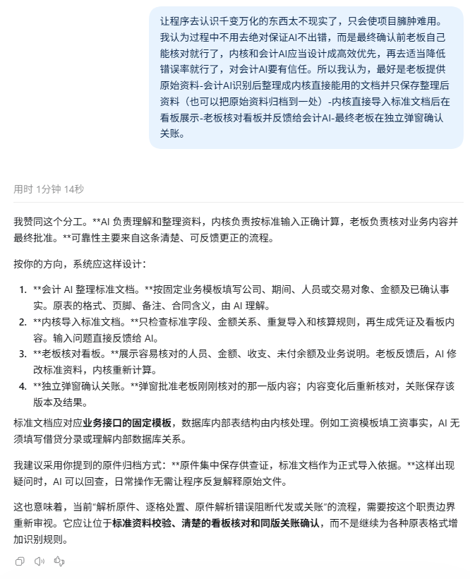

<!-- @format -->

# AI 与内核分工及信任模型讨论记录

记录日期：2026 年 10 月 14 日，Asia/Shanghai。

这次讨论从老板、会计 AI、内核接口、数据库与看板的分工开始，进一步比较了现有和拟议流程的完整性检查，最后重新审视了系统的信任前提。

用户在讨论最后明确提出：

> 不能在“AI是坏人”的前提假设下去设计系统，而是要站在“大家一起努力”的前提假设下去设计，不能盯着漏洞堵，而要追着效率跑。

下文按发言顺序保留用户与 AI 的实质对话，包括 AI 在最后对先前思路的修正。前面的分析应结合后续修正阅读，不能单独当作最终设计约定。本文是讨论存档，不表示相关功能已经实现，也不修改现有项目约定。

原文中的本机源码链接改为仓库相对路径；工具调用和过程进度消息不收录。最初的截图在本文旁保存原始副本。

## 分工设想与当前项目的差异

### 用户

需要改变一下AI与内核分工协作模式。本项目的主体有：老板、会计AI、内核AI接口、数据库、内核看板接口、看板。我觉得理想的流程交互如下：

现实事务发生->由老板确认筛选和采集原始数据->交给会计AI判定和填入模板文档->调用内核AI接口把模板文档直接录入数据库->通过内核看板接口展示到只读看板->老板核对看板与现实事务并反馈循环或最终确认

对此你怎么看，有没有意见或补充？

与当前本项目的差异是什么？

用户同时提供的原始截图：

### AI

我赞同这个方向。**让会计 AI 负责理解现实资料，让内核负责按明确规则计算和保存，让老板负责核对业务真实性和最终批准，这个分工适合本项目。**

对照当前代码看，需要重点改变的是前半段的资料交接方式；后半段的只读看板、反馈更正、独立密码关账，项目已经具备。

你列出的六个主体也合理。其中，“内核 AI 接口”和“内核看板接口”应当共用同一个内核：前者接收业务输入，后者读取核算结果，金额和业务状态采用同一套计算口径。

我建议补充以下几点。

1. **老板确认现实业务和资料范围，会计 AI 负责分类。**

   老板提供“发生了什么、涉及谁、钱是否实际收付、资料是否交齐”。对于无法判断用途或会计性质的材料，也可以直接交给 AI。

   “筛选资料”需要避免变成老板先判断哪些东西应该记账，否则容易把老板不熟悉、实际上需要处理的资料漏掉。

2. **模板文档应当填写业务事实，并保留来源对应。**

   例如，工资模板填写人员、工资所属月、工资项目和有依据的扣款；费用模板填写交易对象、用途、金额、发生期间和付款情况。借贷分录、内部数据库关系和计算结果由内核生成。

   每项业务还应能找到原件页码、表格行或老板的明确说明。原件可以集中归档，日常通过整理后的文档处理；发现差异时，再沿对应关系回查。缺少的事实明确留待解决，不能把未知金额填成零，也不能把只有月份的日期补成某一天。

3. **“直接录入数据库”应当包含内核校验、核算和保存。**

   AI 交出一份标准文档后，内核可以统一完成字段检查、对象关联、重复检查、金额关系检查、确定性核算和事务提交，再返回清楚的处理结果。

   AI 不需要继续手工安排大量内部调用，但内核仍然负责保证重复提交不会多记、失败不会写入一半、更正留下历史。文档修订后重新提交，也要能够明确是在修改哪笔业务。

   这样可以减少操作步骤，同时保留现有核算可靠性。

4. **老板核对看板，需要能够看到具体业务。**

   仅看收入、费用和余额总数不够：漏记一笔 1,000 元，同时重复一笔 1,000 元，总额仍可能正确；记错人、记错月份、把应付当作已付，也可能藏在汇总里。

   看板可以保持摘要优先，展开后提供业务对象、事项、所属期间、金额、实际收付和未结情况。同时清楚提示资料覆盖缺口、尚未明确的业务，以及确实需要老板决定的事项。这些都是老板能够理解的业务内容。

5. **日常反馈更正与最终关账分别处理。**

   AI 可以分批导入，老板随时核对、反馈，AI 修改业务文档，内核更新开放期结果。最终关账时，再由老板通过独立窗口批准刚刚核对的那一版内容；内容变化后重新核对。

   每次导入无需增加一次密码审批。已关账后的更正继续保留原历史，通过关联更正处理。

与当前项目的主要差异如下：

| 方面 | 当前实现 | 你的方案带来的调整 |
|---|---|---|
| 基本职责 | 已经由 AI 整理类型化事实，内核确定计算 | 延续这个分工，把交接边界做得更清楚 |
| 日常业务交接 | AI 通常分别调用证据登记、事实保存、预览、发布及资料关联等入口 | AI 提交标准业务文档，由内核统一安排处理步骤 |
| 原始资料处理 | 内核还承担原文件机械解析、隐藏内容检查、逐项处置和金额、期间关联核验 | 更多原件理解和整理工作交给 AI，内核主要核验稳定的标准输入 |
| 文档导入 | 已有专门用于重建、重放的最终事实文档编译能力 | 需要形成适用于日常新增、更正业务的文档导入入口 |
| 看板 | 已有只读业务看板和逐笔明细 | 重点检查是否足以帮助老板发现遗漏、错人、错期和收付差异 |
| 最终确认 | 已有同版核对、独立密码批准和关账冻结 | 可以沿用，接入新的文档处理流程 |

这里有两个需要准确区分的地方。

**当前内核已经依据 AI 提交的业务事实计算，并没有自行理解所有现实事务。** 它额外承担的是大量原格式解析和逐项覆盖检查。这些检查主要在资料完整性、关账和代发等环节发挥作用，并非每次保存事实都必须解析整份原件。现有流程见[业务登记与核算流程](local-kernel.md)和[材料检查实现](../src/ai_accounting/kernel/materials.py)。

**项目也已经有文档编译能力。** 不过，它目前属于明确范围的重放流程，普通服务不能直接拿它做日常增量导入。可以复用其中的成熟能力，日常入口仍需重新设计。相关实现见[文档编译器](../src/ai_accounting/kernel/replay_document.py)和[重放范围限制](../src/ai_accounting/kernel/replay_runner.py)。

我认为最值得落实的变化是：**把“AI 整理标准文档”建立成正式交接方式，并同步改造资料完整性的检查依据。** 原来由原件逐项解析承担的责任，需要落实到标准业务清单、来源对应、未解决事项和老板对资料范围的确认上。只增加一个模板上传入口，后面仍要求 AI 完成原有全部关联操作，实际效率改善会很有限。

银行流水等结构稳定的资料，则可以继续利用成熟的机器导入和对账能力，减少 AI 转抄工作。具体保留哪些检查，应根据它能发现什么实际错误、需要多少处理成本来决定。

本轮仅核查和讨论方案，没有修改代码、项目约定或业务数据。

## 标准文档交接与完整性责任的展开

### 用户

选中上轮答复中的以下文字：

> 我认为最值得落实的变化是：把“AI 整理标准文档”建立成正式交接方式，并同步改造资料完整性的检查依据。 原来由原件逐项解析承担的责任，需要落实到标准业务清单、来源对应、未解决事项和老板对资料范围的确认上。只增加一个模板上传入口，后面仍要求 AI 完成原有全部关联操作，实际效率改善会很有限。

展开说说这个

### AI

这段话的核心是：**AI 交给内核的标准文档，应当成为一份可以直接处理的业务交接成果。内核接手后，负责完成内部登记、关联、核算和保存。**

同时，要重新回答一个问题：**怎样知道交进来的业务没有遗漏、重复或误解？** 输入方式改变后，这个问题的检查依据也要跟着改变。

可以从一个具体例子理解。

老板提供同一次报销的报销单、发票和银行付款记录。AI 需要判断这些资料之间的关系，整理出：

- 谁报销，报销的是什么事情；
- 应确认的费用金额和所属期间；
- 公司是否已经付款，实际付款日期和金额；
- 哪些原件支持这些事实；
- 还有哪些内容无法确定。

这些内容整理清楚后，AI 就应当能够交接给内核。内核负责把费用、付款及二者关系落实到内部记录，计算未付金额并生成账务结果。

如果 AI 交完模板后，还要继续取得内部计算编号、逐项建立资料处置记录、手工绑定正式结果、更正后再修复关联，主要操作负担就仍然留在 AI 身上。

**第一处变化，是把交接内容从“操作步骤”提升为“完整业务”。**

目前日常流程中，AI 除了理解业务，还要配合多个细粒度接口完成内部操作。新的分工可以这样划：

| 需要完成的事情 | 会计 AI 负责 | 内核负责 |
|---|---|---|
| 理解原件 | 识别事项、金额含义、对象和时间 | 接收整理好的明确事实 |
| 判断资料关系 | 说明哪些资料支持同一业务，哪些存在冲突 | 保存关系并检查引用有效性 |
| 区分业务事实 | 分清费用发生、付款、退款等真实事件 | 按事件类型计算和生成账务 |
| 处理内部记录 | 提供稳定的业务标识和明确身份 | 分配内部编号、绑定版本、建立依赖 |
| 更正 | 指明哪项事实改变、改变原因及来源 | 更新受影响结果，保留历史和审计 |
| 反馈问题 | 先查原件，必要时向老板确认 | 返回具体缺项、冲突及处理结果 |

其中，AI 必须明确的业务关系不能省。例如，“这次付款对应哪笔报销”属于业务事实；“这次付款应绑定哪一个内部计算版本”属于内核实现。两者要分清。

**第二处变化，是让标准文档本身具备完整的交接内容。**

模板里至少需要容纳三类信息：

- **已经明确的业务事实**：可以登记和处理。
- **尚未明确的事项**：具体缺什么，影响哪项业务，不能静默丢弃。
- **资料与业务的对应关系**：发生疑问时，能够找到原件或老板的说明。

还需要有本次交接的范围，例如“某公司某月份的报销业务”，以及提供了哪些资料。

这里尤其要区分：

> “这份模板中的记录都处理成功了”，只能证明提交内容处理完成。
>
> “这个月份的相关业务都已经交齐”，还需要现实资料范围的依据。

如果老板交了十二笔业务，AI 只整理了十笔，内核把这十笔全部处理成功，也不能据此宣布本月资料完整。

**第三处变化，是重新分配完整性检查的责任。**

当前的原件逐项检查，实际承担了好几种不同责任。调整时应分别处理：

| 完整性问题 | 新模式下的主要检查方式 |
|---|---|
| 老板有没有把现实业务资料交齐 | 老板确认交接范围，AI 根据已知业务提示缺口 |
| AI 有没有遗漏或误解原件 | AI 核对原件、保留未解决事项，结合可用的独立合计及老板核对 |
| 提交的业务有没有重复、缺字段或自相矛盾 | 内核检查标准输入 |
| 事实有没有正确形成核算结果 | 内核确定性计算、事务提交和结果核验 |
| 看板展示是否对应当前有效结果 | 内核统一取数并绑定版本 |

这意味着需要接受一个明确的取舍：**当内核不再逐项解析原件时，它就无法独立证明 AI 已经完整理解了原件。**

老板确认“资料已交齐”，也不能自动证明 AI 整理时没有漏项。对于这个缺口，可以保留有实际价值的检查：例如银行期初期末余额、可靠的来源合计、明确的人员名单，以及看板上的逐笔业务核对。单纯由 AI 同时填写“共十笔”和十笔明细，二者相符并不构成独立核验。

这样才能清楚知道哪些可靠性来自程序，哪些来自 AI 整理，哪些来自老板确认。

**第四处变化，是把内部关联的维护交给内核。**

来源对应仍然重要，但可以采用业务层面的表达：

> 这笔报销依据报销单第三项、发票第二页；付款依据银行记录某一笔。

AI 不必再承担“原件处置记录必须指向某个最新内部计算编号”这类维护工作。内核接受业务和来源关系后，应负责将它绑定到实际采用的事实及计算版本。

后续发生不改变业务金额的内部重算时，只要业务及来源关系仍然成立，内核就应维护必要关联。确实出现业务变化或来源冲突时，再返回给 AI 处理。

这一点很关键。**模板减少输入次数，内核接管内部关联维护，才能持续减少后续修复工作。**

**第五处变化，是给文档提交和更正建立清楚的规则。**

日常标准文档入口需要支持这些情况：

- 同一份内容因网络中断重复提交，能够找回原结果，不再记一次。
- 同一业务修改金额、日期或对象，明确作为原业务的修订处理。
- 一份文档中存在缺项，清楚返回哪些业务成功、哪些未处理，并遵守接口承诺的原子范围。
- AI 编辑工作文档后，数据库仍保留此前实际接收的版本及处理回执。

这样，文档便于 AI 整理和修改，数据库负责保存正式接收过什么、实际采用过什么，两边的职责都清楚。

所以，这次调整真正要做的是连在一起的三件事：**设计可交接的标准业务文档，让内核统一执行文档内容，把原来的资料完整性检查改成与新分工相符的检查方式。**

验收时可以用一个很直接的标准：AI 完成业务判断并提交文档后，正常事项能否由内核处理到底；只有业务事实缺失、冲突或需要老板决定时，才需要 AI 再介入。如果正常事项仍大量要求 AI 搬运内部编号、安排调用顺序和修补关联，这个分工就还没有落实。

## 现模式与新模式的完整性检查对比

### 用户

完整性问题在现模式下怎么做的，和新模式对比

### AI

**现模式是“老板确认资料范围，AI 解释原件，内核检查原件中的每项内容是否得到有效处理，老板最后核对”。**

新模式则准备改成：**老板确认资料范围，AI 交出完整的标准业务清单，内核检查清单并核算，老板核对结果。**

两者的主要区别，是内核完整性检查的起点从“原件内容”移到了“AI 整理后的业务清单”。下面的新模式都是建议设计，尚未实现。

现模式具体有六层检查：

1. **检查资料有没有交齐。**

   按公司、月份，对银行、工资、普通业务、税务、资产、融资六类资料建立清单，记录预期资料、实际收到的资料，以及负责人确认依据。

   预期有资料但未收齐，会形成缺项。没有资料也不能自动视为没有业务，需要明确的无业务依据。已经接收的资料不能通过修改清单隐藏掉。

   但“现实中还有一张单据没交给系统”，程序本身无法知道。这一层已经依赖老板和 AI。

2. **检查收到的原件有没有被完整读取。**

   表格会检查工作表、隐藏行列、非空列、金额、公式结果和控制合计。出现未说明用途的非空列、金额缺失等情况，会保留问题。

   PDF、图片、文本则更多依赖 AI 完整阅读，声明页码、位置和摘录。程序不能证明 AI 已经理解了所有内容。

   还有一个边界：**仅把文件保存为证据，不等于已经把它纳入逐项完整性检查。** 原件还需要进入资料处理流程。见[当前资料覆盖流程](material-completeness.md)。

3. **检查原件中的每项内容有没有明确去向。**

   对解析出的业务行，AI 需要说明它属于哪一种情况，例如：

   - 已形成业务并核算；
   - 与其他资料重复；
   - 只是支持材料；
   - 有明确理由无需入账；
   - 属于其他月份；
   - 是合计控制行。

   未处理的业务行会留下问题。跨月资料也需要明确归期，不能默认归到收到文件的月份。

4. **检查“说已处理”是否对应真实有效的结果。**

   对需要核算的原行，系统继续核对：

   - 是否关联到正式采用的核算结果；
   - 金额及所属期间是否一致；
   - 多行合并、单行拆分是否金额守恒；
   - 同一业务金额有没有被重复占用；
   - 关联结果是否已经失效或待更正。

   所以，AI 不能仅填写“这行处理完了”。内核还会沿关联检查实际结果。这也是现模式中内部关联操作较重的原因。见[资料结果关联检查](../src/ai_accounting/kernel/materials.py)。

5. **检查业务和月份是否真正完成。**

   资料处理完成之外，还会检查已保存但尚未正式核算的事实、待更正结果，以及业务模块要求的期间事项。

   关账会集中核验这些问题，最终提交时重新核对。资料或结果变化后，旧预览不能继续使用。见[期间完整性检查](../src/ai_accounting/kernel/periods.py)。

6. **由老板核对业务结果并批准关账。**

   老板核对看板与现实业务，发现差异后交给 AI 更正。最终通过独立密码窗口批准同一版本。

   这一层确认的是老板认可的业务结果，不能替代前面的核算检查。

新旧模式逐项对比如下：

| 完整性问题 | 现模式怎么检查 | 新模式准备怎么检查 |
|---|---|---|
| 现实资料有没有交齐 | 月度分类清单、预期数量、负责人确认 | 保留资料范围确认，可以简化交接形式 |
| 原件有没有漏读 | AI 阅读，加上内核对原格式的机械检查 | 主要由 AI 整理核对；有价值的独立机器检查继续保留 |
| 每项原始业务有没有处理 | 原行逐项处置，未处置则报问题 | 标准清单列出已明确业务和未解决事项，由内核检查清单处理状态 |
| 业务是否正确核算 | 原行关联正式结果，再核对金额、期间和有效性 | 内核直接从标准业务生成结果并维护对应关系 |
| 重算后关联是否仍有效 | 当前需要围绕精确计算版本维护资料关联 | 内核负责维护内部版本关系，业务关系变化再交给 AI |
| 老板是否认可最终结果 | 看板核对、同版密码批准关账 | 保留 |

**关键差别可以用“十二笔报销只整理了十笔”来说明。**

在现模式下，如果原件已经正确接收，内核也正确解析出了十二笔，那么 AI 只处理十笔，剩余两笔会显示为未处理，不能仅凭“十笔已成功入账”就通过完整性检查。

在新模式下，如果内核只收到 AI 整理出的十笔业务，它完全可能把十笔都正确处理。**它没有收到另外两笔的任何信息，就无法知道遗漏。**

新模式要发现这个问题，需要另外的依据，例如：

- 原件可独立读取的十二笔明细或控制合计；
- 已知的交接项目清单，其中两项仍未完成；
- 老板逐笔核对时发现缺少两笔。

如果“共十笔”和十笔业务内容都由 AI 同时填写，两者相符只能证明清单内部一致，不能证明原件没有遗漏。数量相同也不能完全证明内容正确，还可能漏一笔、重复一笔。

因此，**新模式可以明显减少内部编号绑定、接口编排和关联修复，但 AI 逐项理解业务的工作仍然需要完成。** 对原件的独立检查减少后，遗漏发现能力也会发生变化，不能把它当成毫无损失的简化。

我更倾向于按检查价值调整：

- **内核继续负责**标准输入、重复、金额关系、核算结果、版本和关账检查。
- **保留容易获得独立依据的检查**，例如银行流水覆盖与余额、结构稳定表格的明细及合计。
- **复杂原件的语义理解交给 AI**，通过来源对应、未解决事项和老板业务核对形成闭环。

这样，减少的是大量技术操作和低收益的格式适配；哪些完整性能力继续由程序保证、哪些依赖 AI 和老板，也能说明白。

## 重新确定信任前提与效率目标

### 用户

我现在是知道的，其实原来设计的信任模型就错了，是罪魁祸首。不能在“AI是坏人”的前提假设下去设计系统，而是要站在“大家一起努力”的前提假设下去设计，不能盯着漏洞堵，而要追着效率跑。就算是人自己做账也会有遗漏甚至恶意做错账，而会计AI更可能只是遗漏，所以在其他环节尽量弥补AI缺点就好了。作为财务工作，最终影响最大的还是老板，其次是会计，我们无法保证账目绝对正确，只会是随影响力而趋近，权力大的想做成什么样，最终就接近什么样。所以，信任模型不能这么设计，要开放，要追求效率就好了。

### AI

我同意把设计前提改为：**老板和会计 AI 都在努力把事情做好，内核帮助他们高效完成工作，并让错误容易发现、容易修正。**

我前面的分析仍然沿用了旧思路：减少一项检查，就要寻找另一项同等强度的证明来补上。这样很容易把流程重新堆回去，最后只是换了输入形式，工作负担没有减少。这一点需要调整。

**信任 AI，意味着允许它在职责范围内作出业务判断，并接受它整理的结果作为内核输入。** 如果 AI 判断两份资料对应同一业务，内核就应支持保存这个关系；如果它判断某项资料无需入账，系统就记录判断和理由。日常处理不必再要求 AI 通过另一套复杂操作，反复证明自己的判断。

按这个前提，分工可以明确成：

- **老板提供现实信息、作出经营决定、核对结果。** 老板可以遗漏，也可以纠正此前的说法。
- **会计 AI 理解资料、整理事实、判断业务关系、主动查漏和处理反馈。** 系统给予它完成工作的能力。
- **内核接收标准业务输入，完成计算、内部关联、保存和更正。** 正常业务尽量一次提交完成。
- **看板帮助老板发现差异。** 展示人员、事项、金额、期间和收付状态，让核对贴近现实。
- **历史记录帮助大家解释和修正错误。** 保留来源和修改过程，方便找回原因、撤销误操作和恢复工作。

程序检查也要按这个目标重新筛选。金额加总、重复请求不重复记账、失败后不留下半笔数据，这些检查成本低，能够直接减少日常错误，值得保留。要求 AI 为每个原件位置维护复杂处置和计算版本关联，如果主要增加操作负担，就应简化或由内核自动完成。

**完整性也应成为持续改进的工作状态。** 先处理已经明确的业务，保留尚未明确的事项；新资料到来后接续，老板发现差异后更正。某项存在问题时，说明具体影响，其他能够完成的工作继续推进。

你关于责任和影响力的判断，也说明了程序能承担的范围：程序无法保证提供给它的现实描述绝对真实，更无法替代人的意愿和责任。我们可以把精力放在提高正常工作的准确率、缩短处理时间、降低纠错成本上。

因此，下一步设计应主要用这些问题衡量：

- 一项业务需要多少次调用和人工操作？
- AI 是否能自主完成正常事项？
- 老板是否容易看懂并指出差异？
- 出错后能否迅速定位、修正和恢复？
- 检查实际发现了多少错误，又制造了多少无效阻塞？

**“开放、协作、效率优先、方便纠错”可以成为这次重新设计的基础。** 这会改变接口和流程的组织方式，也会改变我们判断一项检查是否值得存在的标准。

## 保存请求

### 用户

感谢你的回答，帮我保存对话到项目中，这是份很有价值的记录。
