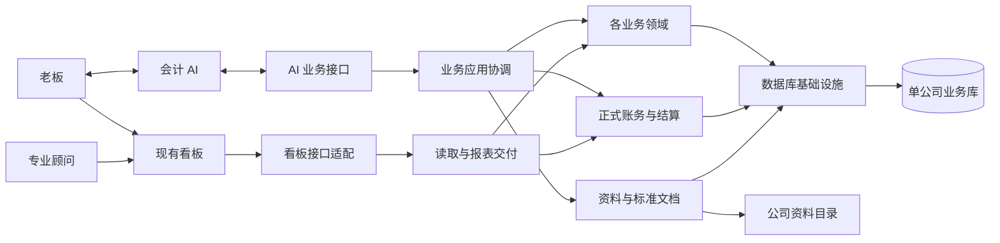

<!-- @format -->

# 整体架构与模块职责

采用模块化单体：一个 Python 后台进程、每家公司一个 SQLite 业务库、现有 Vue 看板。模块可以分别开发、验证和替换内部实现；不把它们拆成需要部署、联网和协调事务的多个服务。拆服务只在出现独立部署或实际容量需要时重新评估。

本文规定职责和协作。字段与调用语义以 [接口合同](03-contracts.md) 为准，物理结构以 [数据设计](04-data-model.md) 为准；开发者不能用自己的私有约定替代它们。

## 六个主体及程序模块

老板通过会计 AI 交付资料和反馈，通过看板核对结果。专业顾问使用同一套只读查阅能力。AI 与看板不直接读写公司库。

数据库是存储模块承接的独立主体，不是每个模块随意共享的公共工作区。看板接口负责把稳定的公开结果转换成旧页面需要的格式，业务领域不依赖 Vue、页面字段或缓存结构。

| 模块及建议目录 | 职责与数据归属 | 可依赖的公开内容 |
| --- | --- | --- |
| `contracts` | 纯数据类型、Schema、状态和错误；无数据库、业务计算及启动副作用。 | Python 标准类型及声明式校验库。 |
| `agent` | AI 工作说明、资料模板、MCP/CLI 业务入口、中文结果解释。引导老板；一次提交完整业务，不编排内部发布、读取失效等步骤。 | `contracts`、`application.public`。 |
| `application` | 用例协调、当前业务身份、提交顺序、影响范围、同公司事务及接续；不自行实现工资、税率等领域公式。 | 各模块的 `public`、`contracts`。 |
| `identity` | 当前人员、组织、账户、项目、产品及资产对象身份与序号；不承接工资、启用等业务事实。 | `contracts`、自身存储端口。 |
| `domains/operations` | 经营收入、费用、其他往来、预付预收事实和计算；通过公开期初资源接续。 | `contracts`、注入的身份/账务/引用读取端口；通过 `domains/taxes.public.tax_point_periods` 查询详细税点的候选月份。 |
| `domains/people` | 人员关系、工资奖金、社保公积金、个人劳务、相关清偿目标。 | `contracts`、注入的身份/账务/引用读取端口；只消费其他模块公开结果。 |
| `domains/assets` | 资产、项目投入、启用、折旧摊销、处置及成本消耗。 | 同上。 |
| `domains/taxes` | 税务资料、政策采用、税费计算/已定税额、申报实际情况。 | 同上及正式税前利润快照。 |
| `domains/financing` | 借款合同、本息、股东资金及投资理财。货币基金、合作项目等是模块内部的不同投资类型，共用公开业务入口。 | 同上。 |
| `money` | 银行、现金、平台账户，实际资金发生、内部划转、银行行及核对；维护真实付款身份，防止重复入账。 | `contracts`、账务结算公开入口、资料引用端口。 |
| `ledger` | 科目映射、正式凭证及分录、债权债务、清偿分配、可消费成本、关账冻结、共享财务取数。 | `contracts`、自身存储端口。 |
| `ledger/opening` | 独立承接期初成员及其公开余额、义务、成本和卡片，不回造历史凭证。 | `contracts`、账务和身份公开端口。 |
| `ledger/reporting` | 报表接续事实及必要累计资料，与正式账务结果分工。 | 同上；不读取期初或领域私表。 |
| `records` | 来源索引、公司说明、当前未解事项、最终标准文档的组织与持久保存；资料路径和校验。 | `contracts`、各领域公开事实导出与当前状态。 |
| `storage` | 目录库与公司库的连接、事务、结构识别、新建及完整基线核验、备份恢复的底层一致性。 | `contracts`、模块提交的结构合同；不解释业务 JSON。 |
| `files` | 当前文件任务的防重、持久状态、运行接续及文件验证；不判断报表、备份或业务含义。 | `contracts`、自身存储端口；由 host 注入生产者 Protocol。 |
| `payments` | 付款文件适配：按明确范围读取当前可付额、组织收款行、采用公司模板并核验代发表；无业务私表，不写实际付款。仅由 `application`、`host` 消费，不被领域、账务、资料或读取模块反向调用。 | 注入的公开业务读取端口，以及 `contracts`、`domains.people/ledger/ledger.opening/identity/records/storage/files.public`。 |
| `reading` | 分页检索、当前读取模型、各页面和报表文件的组装与版本；不得重新决定核算金额。 | `ledger.public`、领域和 `money` 的公开批量查询、`identity/records/storage/files.public`。 |
| `dashboard` | 保持旧 HTTP 线协议、校验器、错误和分页约定，转换 `reading` 结果；只读，不办理批准。 | `reading.public`、`contracts`。 |
| `host` | 启动、依赖注入、HTTP/MCP/CLI 装配、同源会话、后台调度和退出。 | 各模块公开工厂；业务模块不依赖它。 |
| 现有 `frontend` | 保持五页及既有交互，通过现有 API 访问看板适配模块；新增需求独立页面/板块。 | 看板线协议；开发代理通过运行 CLI 的 `dev-proxy-info` 获取连接，不导入 Python 私有实现或推导状态文件位置。 |

Python 实现位于 `src/ai_accounting_modular/`。共享纯函数由对应模块维护，不能绕过公开边界引用总服务；前端与当前后台共用唯一构建和运行入口。

每个程序模块只有 `public.py` 为其他模块可导入的业务入口。仓库内可用普通包和函数，不要求每个类都配接口类；需要替换依赖的边界使用 `Protocol`。内部文件名、私有类、SQL 和 JSON 保存方式不是公开合同。跨模块业务办理由应用层组合；领域可以使用已登记的公开只读端口，不调用对方的应用服务。例如经营模块向税务模块查询详细税点的候选月份，不自行解析税务事件或另选真实收款；双方使用同一事务的事实读取端口。

依赖检查器明确登记模块及方向，未声明的新模块和目标不会默认放行。它检查 Python 的静态导入、私有仓储取得和可识别的 SQL 表归属；跨语言连接另由公开 CLI 合同及 Node 实际调用测试验证。静态检查通过不等于已经证明所有动态调用或注入关系正确，架构复核仍须沿实际调用链确认职责和数据归属。

## 统一的数据分层

1. **来源**证明现实信息，包括原件及老板有效补充；不是“只要有文件就已完成”。
2. **当前事实**是 AI 已整理的正确业务含义。开放期修改覆盖它；撤去误记清空其正文，只留防止迟到重试复活所需的最小身份。
3. **正式结果**是程序依据事实计算并采用的凭证、债权债务、结算、资产成本和财务口径。闭期保留当时必要的采用依据及结果，不能用今天的规则重算覆盖。
4. **交付数据**是标准业务文档、读取模型和导出文件。标准文档独立保存最终事实，供简化重建；读取模型只是可重建的显示加速数据。

当前事实按真实身份和生命周期存放：合同、实际发生、实付款各有身份；新增、更正、预览、发布等程序动作不各建一种业务。领域拥有少量根表，稳定检索项为明确列，其余用严格 Schema 的 JSON。独立修改、范围查询或大量分页的明细另建关系表。凭证、义务、分配、流水及读取索引均用关系表，不把它们藏进通用 JSON 仓库。

薪酬按责任接续：people确认劳动成本、初始应付及后来的有据扣税组成；taxes保存实际申报及报酬分配；money承接员工付款和税款缴纳。后来扣税是员工应付转为个税应付，不重做原工资成本，不冒充付款或申报。各阶段有自己的真实期间，复用账务公开转债和容量核验；不在应用层、代发表或看板再各算一遍。AI怎样判断是否需要问老板由[工作指南](08-ai-work-and-materials.md#不让老板承担程序协调)统一维护，程序字段问题不直接成为老板待办。当前事项的专业核查通过只读accounting_review组合ledger/money公开关系，余额和清偿仍只有ledger计算；同一主体与范围共享依据版本，相关变化才重读，不新增核查状态表。整体分工见[专业核查与办理](13-accounting-review.md)。

公司说明由records在公司库维护唯一正文，标准文档是其自动交付件；新增排版不另建正文库、HTML副本或文章子系统。老板查阅沿 `reading → records公开端口`，dashboard只适配读取，前端只排版；不经过AI业务应用服务或全月模型。公司级范围、明确正文格式及前向资料接续见[公司说明设计](11-company-note.md)。

公开结果都含业务身份、核算期间、结果身份和当前序号。对闭期的采用引用使用正式结果身份；对需要跟随更正的关系使用业务身份。两种引用不同，开发者不能仅凭名称关联。公司隔离由打开的单公司工作单元保证，输入公司与工作单元不一致立即失败。

## 一次完整提交

AI 提交明确事实、来源和业务关系。允许一次包含彼此依赖的业务，例如工资确认和已发生的发薪；也允许只登记工资、以后再登记实付。程序负责建立身份、核算、发布和读取通知，不要求 AI 依次操作这些内部步骤。

办理顺序如下：

1. 在事务外解析文档、校验纯字段和资料文件；确定本次原子业务单元。
2. 打开公司写事务，复查业务当前序号、引用、文件指纹和实际核算依据。读取与计算采用同一工作单元；不采用事务外已经变化的余额。
3. 各模块先声明完整事实中的直接关系，应用统一替换本单关系目录，再收齐责任、核算依赖及发布范围。通知若带入其他已有业务，先补齐其直接关系，再核对完整责任；输入和模块排列顺序不决定结果。应用只对受影响的结果槽按拓扑计算PostingPlan；未变化的槽核对后直接保留正式结果，不重新拼装计划。求值采用精确来源定义；需要剩余量时，先等已声明范围内的全部相关资源使用结果，不读取一半新一半旧的余额。
4. 全部计划齐备后，领域只读核验自己的集合条件，`ledger` 统一核验科目、金额、借贷平衡及资源容量；在同一事务保存当前事实、正式结果、当前关系、文档待归档范围、读取目标版本。最终检查不能临时补改计划，任何一步失败全部回滚。
5. 提交后 `records` 生成最终标准文档并持久替换。只有匹配当前标识的文档才算已归档；文档失败不重记账。
6. 后台产生需要更新的读取模型。读取未就绪不改变账务成功事实，旧结果不能假装是最新结果。

一次办理最多500项业务变更，对象和来源各最多500项；各类明细按唯一 Schema 的相应字段限额，整单不超过8 MiB规范JSON。超限时明确拒绝，按业务上独立的单元拆分，不能把必须原子的关系静默拆开。合法输入产生的内部结果不另设较小数量上限。文件识别、OCR、网络调用、报表Excel生成均不得占用写事务。备份取一致快照时允许短暂阻止新提交，不能边复制活动库边声称一致。

`storage` 创建并结束事务；各模块仓储加入同一个 `UnitOfWork`，不得自行 `commit`、换连接或启动嵌套写事务。公司之间没有分布式原子事务。一笔跨公司资金往来在两家公司分别登记各自真实事实，不能用一家库内调账代替另一家公司账务。

## 核算依赖和更正

应用层分别维护直接事实关系与结果计算依赖。前者只依据完整事实和直接引用，供成员发现和业务检索使用；不读取其他模块推导的关系或结果槽。新增、替换、撤去和模块交接从开始就覆盖旧目录。只有管理含义的事实可以没有记账结果，不为保存关系制造空计划。

各 owner 在统一事实目录上返回 ChangeDescription，再按 `(business_id, result_slot)` 逐槽求值。计算边明确 producer_kind 与 read_mode，正式结果和资源余额参与拓扑，资源使用声明决定余额需要等待哪些槽。基础结果、实际业务和期间汇总可以依次计算，不因同属一笔业务误判循环，也不要求一个领域先算完所有槽。应用只定位受影响节点和安排调用，不扫描全部 JSON 猜依赖，不含领域公式。完整责任和正式结果在同一原子单交叉核对，失败整单回滚。

依赖决定实际顺序。例如经营销售形成税销售，折旧及增值税附加影响税前利润，所得税再读取税前利润；未涉及的计算不必参加。领域声明各槽的税销售或税前利润发布范围，应用据此连接集合消费者，详见[公开合同](03-contracts.md#模块之间的公开能力)，不另写固定阶段调度。所得税不发布税前利润，避免自我依赖。非法循环返回具体关系并整单失败，不让 AI 手工多次发布凑结果。

完整责任与实际重算分开：每项业务始终声明全部有效槽，修改事实时重算该事实的槽；连带通知按具体槽、旧新使用范围及集合发布传播。集合变化若只改变成员目录，可声明只更新责任和依赖，不因此重算既有金额；新增槽及确实变化的计算输入仍须求值。重算计划与精确保留引用必须互斥并完整覆盖责任，未列入完整责任的旧槽才退出。保留结果继续参与资源及财务取数，采用和提交时核对身份、代次、期间和凭证；上游更正后，开放消费者不能沿用失效依据，必要冻结依据按原规则保全。

开放期修改使用原业务身份，以现有序号为前提，覆盖当前事实并重新计算；原凭证编号保留，分录可变化。没有仍有效依赖的误记可撤去。存在真实付款或成本消耗时，先按业务语义更正关系和相关事实，不能为了删错账抹掉真实付款。受影响的开放期结果可在同单原子重算；若闭期结果受影响，则生成发现期冲正和替代，不重写闭期。

单笔或指定多笔撤回沿同一个完整办理入口，用于纠正误记，保留原件。整月撤销是明确的应用能力 `accounting_cancel_month`：应用查齐指定开放月的所属业务，在共同事务中沿各 owner 撤去核算，通过 records 清理对应月份待办、直接保存最终月份说明并退出可清理来源，提交后发布最终文档并接续受控文件清理。它不让 AI 拼领域清单，也不增加流程历史或第二套核算逻辑。最终月份说明只保存当前事实：本月待重新提供资料并从第1项办理；因其他工作而保护保留的来源不等于本期资料已收齐。跨月、长期、模板及冻结保护的来源保留并明确报告；不能把保留项称为已删除。关闭月份拒绝整月撤销，其他月份源业务及自动期间能力保持。

同一更正单可完成多个受影响结果，开发者不能用“先改完一个、再让 AI 修另一个”作为常规实现。若现实事实本身仍冲突，保留原有效结果，返回具体 `fact_issues`。管理资料缺少、无影响的来源补充、无凭证结果不因此生成凭证或冻结全部月份。

闭期采用只保留支持正式凭证和后续计算的必要内容：实际采用的核算字段、规则版本、金额、关系和必要来源。显示备注、手机号等未参与计算的资料不因此冻结。开放期经营说明依据失效时清空旧正文及来源边，只留范围、序号和待更新状态；公司现实背景不随普通账务变化失效。没有被采用的旧错误、已替换的开放期结果、批准预览和操作请求正文不留档。

一个完整结果使用明确的 `result_slot`，例如工资的 main 或资产的 depreciation:2026-01；它可以包含 net_pay 等多个公开义务，不能把平衡凭证拆成互不完整的小结果。槽头仍开放时原位替换；槽头已冻结时，以它为基线在开放期产生关联更正头。冻结 1000 后改成 900，再在同一开放期改成 800，应替换为 1000→800；只有 900 已冻结，才新建 900→800。保存完整的已采用目标，不把冲正净额误当成新的业务金额。

## 重试、并发和最小当前状态

业务身份由程序分配并写回标准文档，来源改名和换行不改变身份。稳定 `business_id` 同时承担调用方防重键，不再另设重复身份；修改/撤去提供 `expected_seq`。每个业务只保存当前序号、当前规范内容摘要和必要的最新提交标识，不保存所有请求及历史响应。

相同身份、序号前提和规范内容的重复请求返回当前结果。旧序号携带不同内容返回 `conflict`；不能覆盖新事实。撤去的身份保留最小墓碑，迟到的原创建不能把它复活；明确恢复误撤才使用原身份和当前序号的 restore。开放期从来源重新整理的新请求可用新身份 create，不强留旧正文或追查旧映射；重试原提交仍沿原身份，不能绕过有效关联和冻结历史。请求结果丢失时，AI 查询当前身份状态，程序不给 AI 增加“重新发布/修复缓存”手续。

事实防重与核算有效性分别判断。结果保存领域核算语义版本和所用公开依据的头；上游变化由依赖图推进结果头，已声明的规则修订按影响清单重算开放结果，冻结结果按更正规则处理。仅实现提速不改变核算语义版本；普通相同事实重试也不触发无范围的重算。

不同业务单元串行进入同公司写事务，SQLite 忙等待上限 3 秒，超时返回可重试 `busy`，不能吞掉错误或无限等。读取走 WAL 快照，分页和报告都绑定所读版本；不把 SQLite 的单写者限制解释为模块不能并行开发。Storage 为写连接设置按需使用的 32 MiB 页缓存建议值，连接结束即释放；只读连接保留 SQLite 默认值，写入仍采用 WAL 和 FULL 同步，事务与模块权限保持一致。

## 文件与数据库的失败接续

不承诺文件系统与 SQLite 天然原子。数据库保存账务与当前待归档标识；归档由正式事实重新生成，不永久保留命令文件、历史快照或事件队列。

| 失败位置 | 对外含义和接续 |
| --- | --- |
| 校验或提交前失败 | 无新增正式账务；返回缺项/冲突/内部错误。 |
| 数据库提交失败 | 保持原有效账务和文档，不发布新的最终文档。 |
| 库已提交，文档失败 | `accounting=saved, documents=pending`，整单尚未完整办结；按当前事实重新归档，不再次入账。 |
| 文档已保存，状态确认前中断 | 比对文件头与当前待归档标识，匹配则补确认。 |
| 全部保存后回复丢失 | 查询当前业务结果及文档状态，返回实际内容。 |
| 文档尚未完成而数据库毁损 | 不承诺该项已经存在于可重建资料；根据仍在的当前输入查证，不能伪称已交付。 |
| 文档完成后数据库毁损 | 用最终标准文档建立简化新账；原账的冻结及冲正过程只能从数据库备份恢复。 |

文档按领域和归档月分片，以一个当前清单引用完整集合。先持久生成全部变化片，再一次原子替换清单；跨月移动不会出现一半删除、一半未新增的中间集合。未变片复用，切换后清理不再引用的片，不保存历次清单。

同一文档生成中若事实再次变化，旧任务不得覆盖新文档或清除新待办。以当前目标标识比较后发布；过时计算直接丢弃。临时文件使用同目录写入、同步、原子替换，异常后清理临时产物；不为它另建永久事务日志。

## 看板隔离与读取一致性

领域只输出业务结果及变化类别，不输出“刷新员工卡片”等页面命令。`reading` 根据公开结果维护自己的范围和组件目标版本；登记结果与读取目标变更同事务保存，后台通知只用于唤醒，丢失后仍可按目标与就绪版本差异接续。

页面快照由组件版本组合而成。只改工资时，资金或资产没有相关实际变化的组件可复用；页面有统一快照标识不等于全量重算。三表和财务摘要的选择、计算及版本由 `ledger` 统一提供；`reading` 保存可重建的准备资料，先准备实际相关的财务范围，再生成月页和季度页，不复制会计公式。

准备资料发布时同时核对原基底和当前待办，旧任务不能覆盖新目标或清掉新待办。页面只核对自己实际使用的财务范围，不因另一月份仍在准备或失败而无法完成。已就绪页面继续使用自身完整模型。程序构建号变化不能自动让全库读取失效；规则或结果确实变化时，按明确影响范围更新。

`reading` 在统一读快照中批量调用公开取数，不按一张卡片一次调用领域。分页先选所需业务身份，再批量补充完整凭证和明细；所有总额来自完整范围的共享正式结果，不能累加已加载页面。没有最新模型时明确 `preparing`，失败明确 `failed`，不返回旧金额冒充当前结果。具体线协议、口径及性能验收见 [看板适配](06-dashboard-adapter.md)。

## 备份、恢复和简化重建

应用层的 `capture_backup_snapshot` 在同公司提交/文档发布协调边界内绑定数据库快照 head、已发布 set_id 和必要来源集合，取得文件使用租约后再释放边界并复制打包。storage 只负责数据库一致快照，records 负责文档/来源集合；两者不得自行猜对方的私有数据。

备份先核对 ZIP 的精确文件集合、原字节、完整结构合同及公司数据库身份，再由各 owner 检查凭证、资源、冻结依据及标准文档与当前事实是否一致。应用按完整事实核对直接关系目录，并将完整责任承诺与账务当前有效槽双向核对，不能让“事实还在、关系或正式账已丢失”的空账通过。核验不以今天的公式重算历史账。文档待归档时先接续，不能交付账务和文档不同步的包。只有备份、报表导出使用当前文件任务；恢复和重建直接处理选定包或清单，不往源库写任务。

当前版和上一版均采用已验证的完整包。SQLite 维护导致物理字节变化时，相同公司、数据库、业务版本、结构及资料集合复用已安装原包；捕获后的新业务不使原一致点失效，较早捕获也不能覆盖已安装的更新备份。滚动中断只用受控临时完整旧包接续，损坏包不能提升为上一版；不建立永久操作日志。

离线 check 在临时位置完成实际构建及验证，不创建目标；run 在目标同卷的独立暂存目录完成后，通过原子且无覆盖的目录发布交付，再明确登记接入。已有目标即使为空也不覆盖。恢复只复制清单文件，不把校验时产生的 SQLite 旁文件带走；在同一维护事务中清除派生读取和旧文件任务，保留正式账务、冻结及必要历史。无源目录库、负责人登录记录或源服务也能执行。

简化重建只使用标准业务文档中的最终事实和必要来源，建立新的公司运行身份、数据库及正式结果身份；不访问原目录，也不创建老板身份或目录库，交付后另行登记接入。文档自带的稳定业务/对象/来源身份用于解析文档内部引用，不读取旧库继承隐藏状态。按事实依赖和所属期间核算，不回放错误、冲正、旧编号和旧关账动作。文档中的真实退款、利息、损失、付款和风险承担仍是事实。重建后的净资产、真实义务、真实现金发生及最终有效事实应符合重建样例，不要求与旧账逐月凭证数、编号或纠错期间一致。

读取模型重建只重新生成显示数据，不重记账。备份恢复、简化重建和读取重建是三个独立命令，不用一个“恢复”按钮含糊承接。

备份任务重启后，先根据已捕获 BackupPlan 恢复其文档/来源文件引用租约，再执行任何资料清理。捕获集缺失或不匹配时明确失败，不能悄悄抓一套新数据沿旧 head 交付。只保当前计划，不增加操作日志或另一套任务数据库。

## 边界保护

自动检查导入方向、仅允许公开入口、表归属和结构合同；跨模块测试通过公开工厂构造真实依赖。禁止从 `reading` 访问领域私表，禁止从领域导入 dashboard/reading/host，禁止把 SQL 查询复制到每个消费者重新判断业务。

公开数据合同、模块结构合同和显示模型格式分别版本化。内部表变更不改变公开业务合同就不要求消费者改写；公开合同确需变化时，先修订唯一 Schema 和对应共同样例，再在同一交付批次更新消费者。开发期不维持两套长期接口，也不能绕过旧前端校验器偷偷少返回字段。

身份由 identity 独立承接，records、reading 及领域通过公开端口读取，不能为拿对象名称而反向导入 application。应用层只协调各 owner，不成为所有模块必须反向依赖的公共中心。

每次拟新增公共机制，先用现有模型检验：这是新的现实事实，还是同一事实的内部步骤？是否能通过明确归属、一次原子提交和当前目标状态解决？只有多个模块确有相同、稳定含义才抽到公共层。不得用万能业务引擎、永久事件历史、全局规则开关或通用审批框架填补职责不清。
