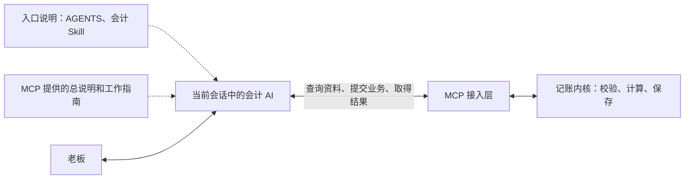

<!-- @format -->

# 会计 AI 流程说明

老板说“开始记账”后，当前会话中的 AI 会先读取会计工作的指引，再查看公司的实际情况，决定接下来做什么，并通过工具把业务交给记账内核。

要理解它怎样受到约束，关键是分清两件事：**文字要求由 AI 理解和遵守；真正写入账本的业务，由内核按代码检查。** 这两部分通过 MCP 连接起来。MCP 可以理解为 AI 与内核之间的工具通道。

## 一、这套架构里，谁负责什么

**会计 AI 负责理解和决策。** 它读老板的话、资料和工作指南，判断业务性质、选择下一步、决定是否还需要提问，再组织要提交的业务事实。

**MCP 接入层负责交接。** 它把工作说明、资料查询和记账工具提供给 AI，把 AI 的请求送给内核，再把结果返回。这个接口本身不会思考，也不会逐句监督 AI 的回答。

**记账内核负责确定的处理。** 它根据明确的业务事实计算、校验和保存。比如借贷是否平衡、同一笔业务是否重复提交、已关账月份能否这样更正，都是代码检查。

图中的虚线表示文字指引，实线表示实际交互。文字指引影响 AI 怎样工作，内核检查决定提交的业务能否保存。

## 二、“开始记账”怎样把规则带进来

### 第一步：入口说明让 AI 选择会计工作方式

项目的 [AGENTS.md](AGENTS.md) 写明：收到“开始记账”或实际业务资料时，使用会计 Skill。

这里的“进入会计模式”，是当前 AI 按这套要求工作。入口文件是一份给 AI 阅读的指令，不是一个独立运行的流程程序。

### 第二步：Skill 告诉 AI 先读哪份说明

[会计 Skill](.agents/skills/accounting-operator/SKILL.md) 相当于入门说明。它告诉 AI：开始或恢复记账，先读取 `accounting://guides/work`，然后再查公司的状态、使用内核工具。

Skill 只保留必要提醒和阅读入口。完整工作方法放在工作指南中，避免每个入口各维护一套规则。

### 第三步：MCP 连接也提供一份总说明

连接会计 MCP 时，服务会把[会计助手总说明](src/ai_accounting_modular/agent/public.py)交给客户端，作为使用这些工具的指引。里面也提醒 AI 先读工作指南、复用已有资料、只问必要事实。

这给了 AI 另一个明确入口，但不会自动把所有指南正文都读完。详细指南仍需要 AI 主动读取。

### 第四步：AI 读取工作指南，内容进入当前会话

AI 通过 MCP 读取 `accounting://guides/work` 后，指南正文作为工具返回内容进入当前会话。AI 再结合老板的话、已有资料和工具结果，决定下一步。

所以，这条约束链是：**入口要求使用 Skill → Skill 和 MCP 总说明要求读取指南 → AI 读取并理解指南 → 按指南工作。**

开始或恢复工作时要求先读，并不等于每次回复前都重新读取一遍。已经读到的内容在会话中继续使用；需要补充规则时，再按需读取。

## 三、具体业务的规则怎样加入

工作指南解决“怎样带老板办理、怎样提问、怎样接续”的问题。遇到具体业务时，AI 还要查询当前内核支持哪些业务，并读取对应的专项指南和输入要求。

例如办理工资，AI 才读取工资规则；办理投资，才读取对应投资规则。专项指南通过 `accounting://guides/business/{kind}` 提供，当前支持范围和输入要求通过 `accounting_schema` 及命令合同取得。

这些内容进入会话后，AI 才据此整理请求。它不必在开始时读完全部架构和业务文档，也不能因为看过一份设计说明，就认为运行中的内核已经支持其中全部能力。

公司说明、已有业务和待办则是另一类输入：它们告诉 AI **这家公司实际是什么情况、已经做到哪里**。工作指南与业务资料共同决定下一步，不能只照通用清单机械提问。

## 四、以“先查资料，只问必要问题”为例

这条要求的详细正文写在[工作指南的开发文档](docs/redesign/08-ai-work-and-materials.md)中。Skill 和 MCP 总说明保留简短提醒，AI 开始工作时再读取完整指南。

收到一笔业务后，AI 应结合已经知道的情况判断，再查必要资料。如果现有资料已经足够，它就继续办理；仍有影响当前工作的现实事实无法确定，才向老板提问。

**这一步目前靠 AI 按指引作判断。程序没有在问题发出前检查“它是否已经查过资料、这个问题是否必要”。**

如果 AI 多问了一个不必要的问题，问题可能出在没有读取指南、没有正确理解指南，或没有结合已有资料执行。仅看文件里写了这条要求，不能证明某次对话已经遵守；需要看实际会话的读取记录和回答表现。

## 五、AI 提交业务后，程序怎样约束它

AI 理解完业务，通过 MCP 提交有明确类型的业务事实。内核公开的记账入口不接受 AI 随意指定借贷分录。

请求进入内核后，程序检查字段、来源、业务关系和金额，执行计算，再决定能否保存。检查不通过就返回具体问题，不能靠 AI 在对话里说“已经处理”来代替。

这里与提问规则的区别是：**文字要求影响 AI 怎样作决定；程序检查直接影响账本能否被写入。** 两者各自负责不同的部分。

返回问题后，AI 还要理解它的含义：哪些能从已有资料补齐，哪些是程序问题，哪些才真正需要老板提供信息。这又回到工作指南的要求，不能把内核报错直接转成老板问卷。

业务保存、标准文档完成、看板准备就绪也各有实际结果。AI 根据这些结果反馈和接续，不能只凭自己的计划宣布完成。

## 六、规则修改后，怎样才算实际生效

详细规则的原文保存在项目文档中：[工作方法](docs/redesign/08-ai-work-and-materials.md)、[接口说明](docs/redesign/03-contracts.md)、[业务规则](docs/redesign/05-business-rules.md)和[报表规则](docs/redesign/05b-financial-reporting.md)。

[生成工具](tools/generate_modular_contracts.py)从这些原文提取操作所需内容，形成随内核提供的[指南包](src/ai_accounting_modular/agent/_guides.json)。MCP 再把指南包中的内容提供给 AI。因此，AI 日常读取的是运行版本提供的指南，不是直接翻源码目录中的开发文档。

一条修改要影响实际工作，需要经过三个环节：

1. **原文和指南包一致。** 修改详细规则后，重新生成对应指南。
2. **运行中的 MCP 加载新版。** 指南会被进程缓存，总说明也在进程中加载；仅修改文件或提交 Git，不会自动刷新已运行的旧进程。
3. **会计会话读取新版内容。** AI 需要取得更新后的指引，才能据此工作。重新连接仍存活的旧进程，未必能刷新缓存。

核对是否生效，要看运行中的连接返回了什么、AI 实际读到了什么，以及随后怎样办理。本文只是解释这套架构，不是会计 AI 启动时自动读取的另一份规则文件。
